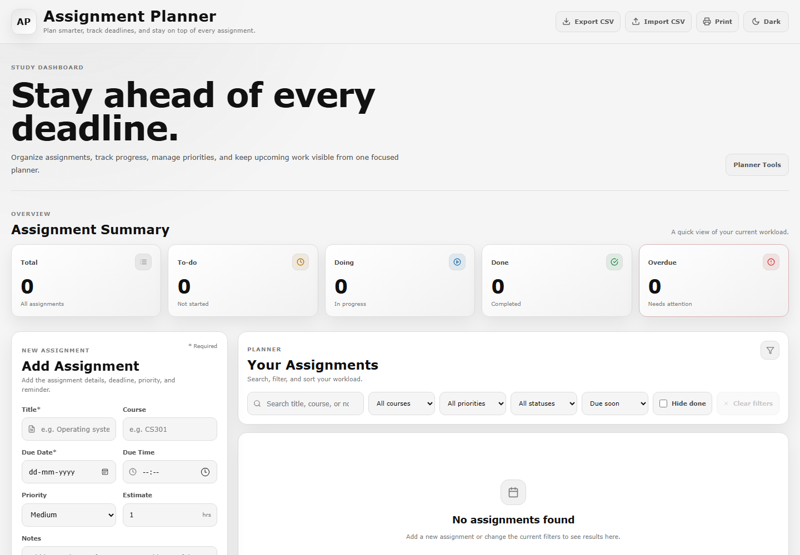

# Assignment Planner

Assignment Planner is a responsive React workspace for organizing coursework, tracking deadlines, managing priorities, and monitoring study progress. Data stays in the browser, so no account or backend is required.



## Features

- Create, edit, complete, and delete assignments
- Search, filter, sort, and hide completed work
- Summary cards for to-do, in-progress, completed, and overdue work
- CSV import and export
- Calendar `.ics` export for individual assignments
- Light and dark themes saved with LocalStorage
- Responsive table and mobile card views
- Keyboard-friendly dialogs, loading states, and confirmations
- Fixed auto-hiding header, mobile menu, footer links, and back-to-top control

## Tech Stack

React, Vite, JavaScript, styled-components, React Icons, LocalStorage, CSV, and iCalendar.

## Run Locally

```bash
npm install
npm run dev
```

Run checks and a production preview:

```bash
npm run lint
npm run build
npm run preview
```

## Deployment

Live app: [https://a2rp.github.io/assignment-planner/](https://a2rp.github.io/assignment-planner/)

```bash
npm run deploy
```

## Future Prospects

- Add recurring assignments and richer calendar views.
- Add optional reminders and workload planning by week.
- Add more export formats and progress insights.

## Images

The main project preview is stored at `screenshot.png`. Favicon, logo, and social preview assets are stored locally in `public/`.

## License

MIT License. Copyright (c) 2026 Ashish Ranjan.

## Links

- Portfolio: [https://www.ashishranjan.net/](https://www.ashishranjan.net/)
- GitHub: [https://github.com/a2rp](https://github.com/a2rp)
- CodePen: [https://codepen.io/ash1198](https://codepen.io/ash1198)
- LinkedIn: [https://www.linkedin.com/in/aashishranjan](https://www.linkedin.com/in/aashishranjan)
- Facebook: [https://www.facebook.com/theash.ashish/](https://www.facebook.com/theash.ashish/)
- YouTube: [https://www.youtube.com/@ashishranjan-ashz?sub_confirmation=1](https://www.youtube.com/@ashishranjan-ashz?sub_confirmation=1)
- Email: [ash.ranjan09@gmail.com](mailto:ash.ranjan09@gmail.com)

## Support

- Support: [https://a2rp-donation-page.netlify.app/](https://a2rp-donation-page.netlify.app/)
- Buy Me a Coffee: [https://buymeacoffee.com/a2rp](https://buymeacoffee.com/a2rp)
- Patreon: [https://patreon.com/a2rp](https://patreon.com/a2rp)
