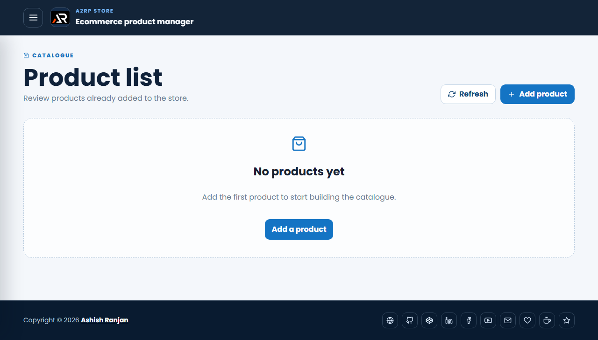

# Ecommerce Product Manager

A responsive React frontend for creating products and browsing a catalogue through a connected ecommerce API. Product images are uploaded by the backend to Cloudinary.

**Collection source:** [React Projects](https://github.com/a2rp/react_projects/tree/main/projects/ecommerce-fronend)



## Features

- Browse products with image, INR price, category, and description
- Add products with a local image preview
- Accept JPG, PNG, and WEBP images up to 5 MB
- Responsive navigation, loading and empty states, and toast feedback
- Hash-based routes that work with GitHub Pages refreshes

## Tech stack

React, Vite, React Router, Axios, Material UI, styled-components, React Toastify, and React Icons.

## Run locally

```bash
npm install
npm run dev
```

The frontend uses `http://localhost:5000` for the local API and a hosted Render API in production. Set `VITE_BACKEND_URL` in `.env.local` to use another API URL. Start the [ecommerce backend](https://github.com/a2rp/ecommerce-backend) and configure its CORS allowlist to include the frontend origin.

## Build and deploy

```bash
npm run lint
npm run build
npm run deploy
```

The Vite base path is configured for GitHub Pages. Hash routing keeps the product list and add-product screens available after direct navigation or refresh.

Live app: [https://a2rp.github.io/ecommerce-fronend/](https://a2rp.github.io/ecommerce-fronend/)

## Links

- Portfolio: [ashishranjan.net](https://www.ashishranjan.net/)
- GitHub: [a2rp](https://github.com/a2rp)
- LinkedIn: [Ashish Ranjan](https://www.linkedin.com/in/aashishranjan)
