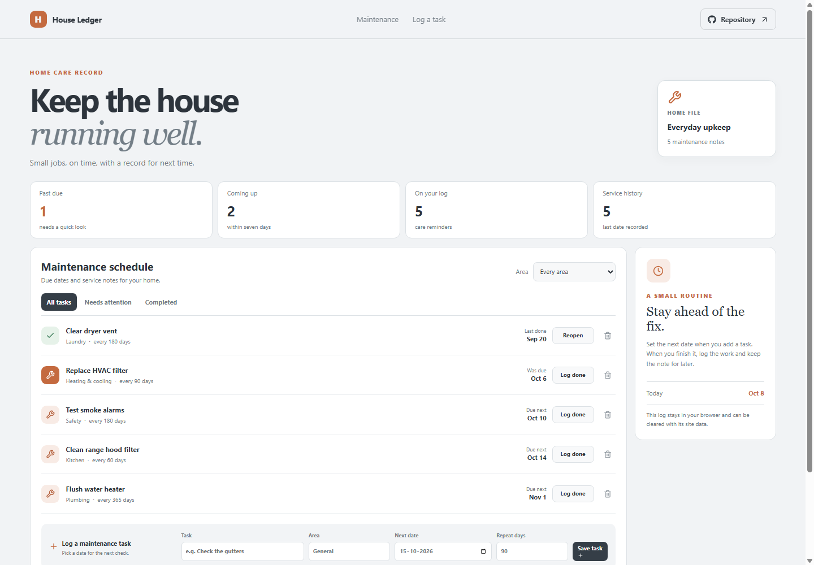

# House Ledger: Home Maintenance Log

House Ledger keeps recurring home-care work and service dates together. It is intended for small household reminders such as filters, alarms, vents, and seasonal checks.

**Source code:** [react_projects/projects/home-maintenance-log](https://github.com/a2rp/react_projects/tree/main/projects/home-maintenance-log)

## Included

- Track maintenance title, home area, next due date, and repeat interval.
- See past-due and next-seven-day counts at a glance.
- Filter the schedule by area, attention needed, or completed status.
- Log completed work and reopen an entry if it needs attention again.
- Delete a maintenance note through a confirmation dialog.

## How to use it

Add a task, area, due date, and repeat interval. When the work is done, select Log done; the app records the completion date and calculates the next due date from the repeat interval. The item moves to Completed. Reopen returns it to the active schedule with that next due date.

## Data and limits

Maintenance notes live in localStorage in this browser. Logging work records the date completed and schedules the next check using the selected interval. The app does not send reminders or calculate costs.

This is a browser-only utility. Clearing the browser’s site data removes its saved information.

## Run locally

~~~sh
npm install
npm run dev
~~~

## Checks and deployment

~~~sh
npm run lint
npm run build
npm run deploy
~~~

The original Vite and GitHub Pages configuration is kept for portability. Since this folder is part of the `react_projects` collection, run its deploy script only after placing the project in a standalone repository configured for its own Pages site.

## Future improvements

Ideas only. These are not implemented yet:

- Add photo and receipt attachments.
- Send calendar reminders for due dates.
- Export a home service history for a move or sale.

## Links

- Portfolio: [https://www.ashishranjan.net](https://www.ashishranjan.net)
- GitHub: [https://github.com/a2rp](https://github.com/a2rp)
- CodePen: [https://codepen.io/ash1198](https://codepen.io/ash1198)
- LinkedIn: [https://www.linkedin.com/in/aashishranjan](https://www.linkedin.com/in/aashishranjan)
- Facebook: [https://www.facebook.com/theash.ashish/](https://www.facebook.com/theash.ashish/)
- YouTube: [https://www.youtube.com/@ashishranjan-ashz?sub_confirmation=1](https://www.youtube.com/@ashishranjan-ashz?sub_confirmation=1)
- Email: [mailto:ash.ranjan09@gmail.com](mailto:ash.ranjan09@gmail.com)

## Support

- Support: [https://a2rp-donation-page.netlify.app/](https://a2rp-donation-page.netlify.app/)
- Buy Me a Coffee: [https://buymeacoffee.com/ashishranjan](https://buymeacoffee.com/ashishranjan)
- Patreon: [https://www.patreon.com/ashishranjan](https://www.patreon.com/ashishranjan)
