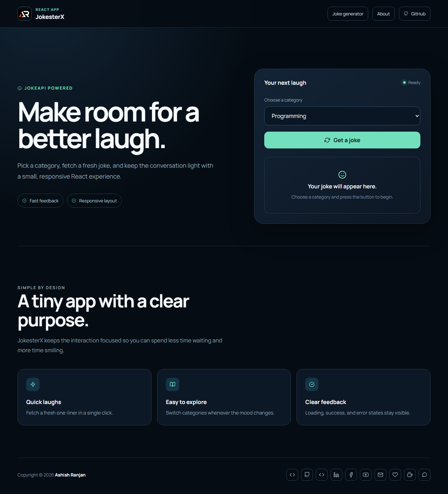

# JokesterX

**Collection source:** [React Projects](https://github.com/a2rp/react_projects/tree/main/projects/jokesterx)

JokesterX is a responsive React joke generator powered by JokeAPI. Choose a category, fetch a fresh one-liner, and copy it with a focused, accessible interface.

## Features

- Joke categories with loading and error states
- Copy-to-clipboard action for fetched jokes
- Responsive fixed header with local branding
- Icon-only social and support links in the footer
- Accessible go-to-top control and GitHub Pages deployment

## Tech stack

React, Vite, styled-components, react-icons, and JokeAPI.

## Run locally

```bash
npm install
npm run dev
```

Build and deploy:

```bash
npm run lint
npm run build
npm run deploy
```

## Screenshot



## Links

- Live: [https://a2rp.github.io/jokesterx/](https://a2rp.github.io/jokesterx/)
- Source repository: [React Projects](https://github.com/a2rp/react_projects/tree/main/projects/jokesterx)
- Portfolio: [https://www.ashishranjan.net/](https://www.ashishranjan.net/)
- GitHub: [https://github.com/a2rp](https://github.com/a2rp)
- CodePen: [https://codepen.io/ash1198](https://codepen.io/ash1198)
- LinkedIn: [https://www.linkedin.com/in/aashishranjan](https://www.linkedin.com/in/aashishranjan)
- Facebook: [https://www.facebook.com/theash.ashish/](https://www.facebook.com/theash.ashish/)
- YouTube: [https://www.youtube.com/@ashishranjan-ashz?sub_confirmation=1](https://www.youtube.com/@ashishranjan-ashz?sub_confirmation=1)
- Email: [ash.ranjan09@gmail.com](mailto:ash.ranjan09@gmail.com)

## Support

- Support: [https://a2rp-donation-page.netlify.app/](https://a2rp-donation-page.netlify.app/)
- Buy Me a Coffee: [https://buymeacoffee.com/a2rp](https://buymeacoffee.com/a2rp)
- Patreon: [https://www.patreon.com/a2rp](https://www.patreon.com/a2rp)
