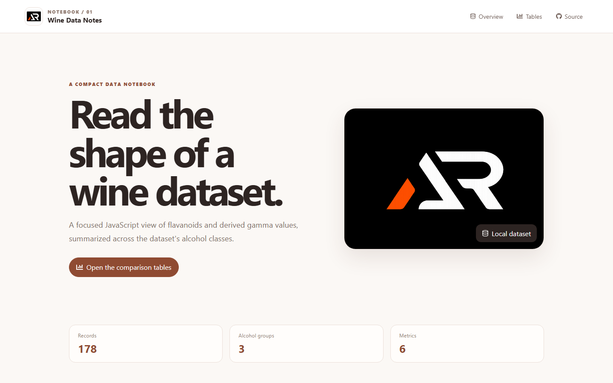

# Wine Data Notes

A React data notebook that groups wine records by class and compares class-wise Flavanoids and derived Gamma statistics.

## Features

- Grouped wine records by the dataset's class label
- Mean, median and mode summaries for flavanoids and gamma
- Gamma is calculated per record as `(Ash × Hue) ÷ Magnesium`
- Responsive comparison tables and dataset overview
- Fixed responsive header with mobile navigation
- Full icon-only footer links and a floating go-to-top control
- Simple border and shadow interactions

## Tech stack

React, Create React App, JavaScript, Sass modules and React Icons.

## Data and calculations

The bundled 178 wine records follow the [UCI Wine recognition dataset](https://archive.ics.uci.edu/dataset/109/wine). The data file is normalized to the dataset's field names before calculations; the class label is kept separately from the Alcohol measurement. Proline is omitted because the dashboard does not use it. The tables show the mean, median and mode of Flavanoids and per-record Gamma for each class.

## Run locally

    npm ci
    npm start

Create a production build with npm run build.

## Deployment

Live demo: [a2rp.github.io/manufac-yarn-refactored-code](https://a2rp.github.io/manufac-yarn-refactored-code/)

**Collection source:** [a2rp/react_projects/projects/manufac-yarn-refactored-code](https://github.com/a2rp/react_projects/tree/main/projects/manufac-yarn-refactored-code)

This is the Yarn/Create React App variant of the Wine Dataset Statistics project; the collection also includes JavaScript and TypeScript implementations.

## Future improvements

The notebook can be extended with filters, charts and downloadable summaries.

## Links

- Portfolio: [https://www.ashishranjan.net](https://www.ashishranjan.net)
- GitHub: [https://github.com/a2rp](https://github.com/a2rp)
- CodePen: [https://codepen.io/ash1198](https://codepen.io/ash1198)
- LinkedIn: [https://www.linkedin.com/in/aashishranjan](https://www.linkedin.com/in/aashishranjan)
- Facebook: [https://www.facebook.com/theash.ashish/](https://www.facebook.com/theash.ashish/)
- YouTube: [https://www.youtube.com/@ashishranjan-ashz?sub_confirmation=1](https://www.youtube.com/@ashishranjan-ashz?sub_confirmation=1)
- Email: [ash.ranjan09@gmail.com](mailto:ash.ranjan09@gmail.com)

## Support

- Support: [https://a2rp-donation-page.netlify.app/](https://a2rp-donation-page.netlify.app/)
- Buy Me a Coffee: [https://buymeacoffee.com/a2rp](https://buymeacoffee.com/a2rp)
- Patreon: [https://patreon.com/a2rp](https://patreon.com/a2rp)
