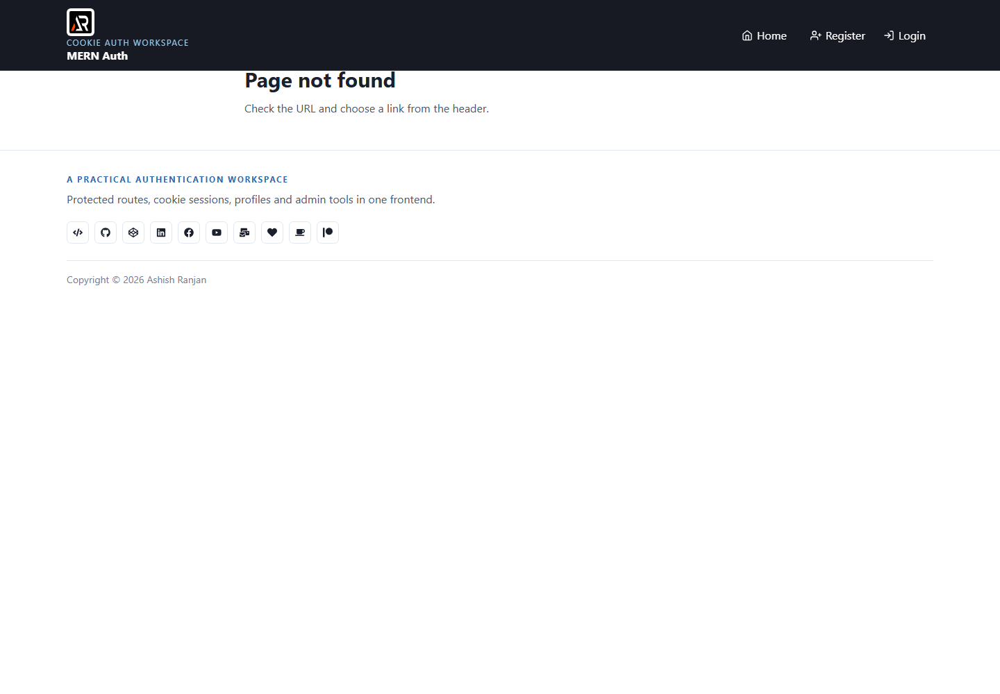

# MERN Auth Chakra Frontend

A React and Vite client for the companion [Express and MongoDB API](https://github.com/a2rp/expressjs_backend_projects/tree/main/apps/mern-auth-chakra-backend). The app demonstrates HttpOnly cookie sessions, protected routes, profile management, and role-based admin tools.



## Features

- Registration, login, dashboard, profile, and protected routes
- HttpOnly cookie sessions restored through the API
- Profile and password management
- Admin user search, pagination, sorting, and role updates
- Responsive Chakra UI interface

## Run locally

Start the backend API first, then configure and run this client from this folder:

```bash
npm ci
```

Copy `.env.example` to `.env.local` and set `VITE_API_URL` to the backend origin without `/api`. It defaults to `http://localhost:1198`.

```bash
npm run dev
```

The API must allow the frontend origin in its `FRONTEND_URL` setting. See the [backend setup guide](https://github.com/a2rp/expressjs_backend_projects/tree/main/apps/mern-auth-chakra-backend) for its environment variables and run commands.

## Routes

- `/` — overview
- `/register` — create an account
- `/login` — sign in
- `/dashboard` — protected dashboard
- `/profile` — protected profile and password settings
- `/admin` — admin-only user management