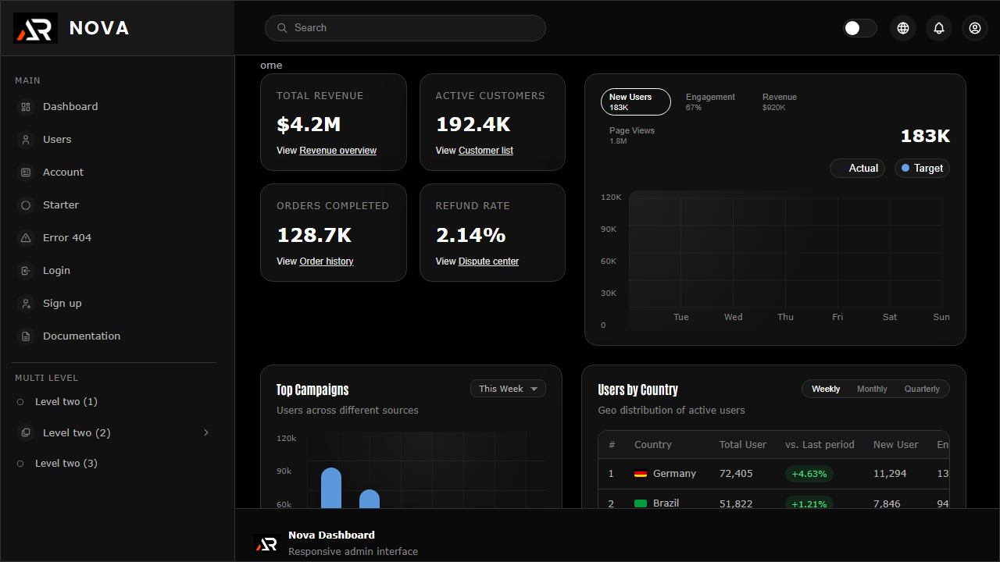

# Nova Admin Dashboard

Nova is a responsive React admin dashboard demo for analytics, user management, account settings, and reusable application screens. Its sample records and account flows are frontend-only; no real backend or authentication service is connected.



## Features

- Dashboard metrics, charts, campaigns, and user views
- Responsive sidebar and header with mobile navigation
- Dark and light themes saved in browser local storage
- Account settings, login and signup screens, documentation, and error states
- Sample data and demo interactions for exploring common admin workflows

## Tech stack

React, Vite, React Router, styled-components, Material UI, Recharts, React Icons, React Toastify, and Zustand.

## Requirements

- Node.js 22.13 or newer in the 22.x line, or Node.js 24 or newer
- npm

## Run locally

```bash
npm ci
npm run dev
```

To create a production build, run `npm run build`.

## Collection

Nova is part of [React Projects](https://github.com/a2rp/react_projects/tree/main/projects/nova).

## Links

- Portfolio: [https://www.ashishranjan.net/](https://www.ashishranjan.net/)
- GitHub: [https://github.com/a2rp](https://github.com/a2rp)
- LinkedIn: [https://www.linkedin.com/in/aashishranjan](https://www.linkedin.com/in/aashishranjan)
- Email: [mailto:ash.ranjan09@gmail.com](mailto:ash.ranjan09@gmail.com)

## License

MIT