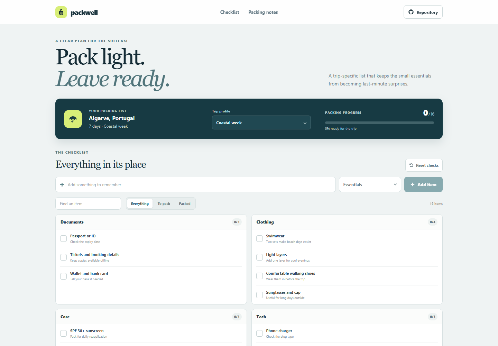

# Packwell - Packing Checklist

Packwell is a trip-specific packing planner. Choose a trip profile, check off packed items, and add personal reminders as the plan changes.



## Features

- Three sample trip profiles with separate checklists
- Progress count, percentage, and progress bar for each trip
- Items grouped by packing category, with search and packed/unpacked filters
- Add custom items to a category and remove them with confirmation
- Reset a trip checklist with confirmation
- Responsive layout, explanatory packing notes, and go-to-top control

## Privacy and storage

Trip profiles, packed states, and custom items are stored in this browser's `localStorage` under `packwell-workspace`. The app does not upload personal packing notes. Clearing site data removes saved lists.

## Future improvements

These ideas are not implemented yet:

- Set trip dates and adjust clothing quantities by trip length
- Copy optional packing templates into a new trip profile
- Print or export a checklist as text
- Create custom trip profiles and categories
## Requirements

- Node.js 20.19+ or 22.12+
- npm

## Run locally

```bash
npm ci
npm run dev
```

Run `npm test`, `npm run lint`, and `npm run build` for the available checks.

## Collection

Packwell is part of [React Projects](https://github.com/a2rp/react_projects/tree/main/projects/packing-checklist).

## Links

- Portfolio: [https://www.ashishranjan.net](https://www.ashishranjan.net)
- GitHub: [https://github.com/a2rp](https://github.com/a2rp)
- LinkedIn: [https://www.linkedin.com/in/aashishranjan](https://www.linkedin.com/in/aashishranjan)
- Email: [mailto:ash.ranjan09@gmail.com](mailto:ash.ranjan09@gmail.com)

## Support

- Support: [https://a2rp-donation-page.netlify.app/](https://a2rp-donation-page.netlify.app/)
- Buy Me a Coffee: [https://buymeacoffee.com/ashishranjan](https://buymeacoffee.com/ashishranjan)
- Patreon: [https://www.patreon.com/ashishranjan](https://www.patreon.com/ashishranjan)