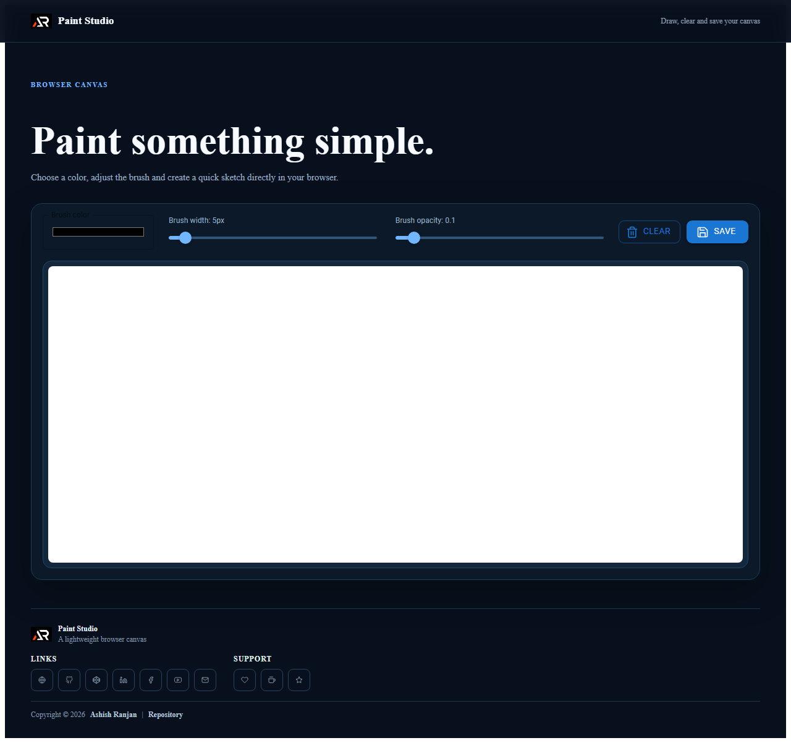

# Paint Studio

A responsive React canvas app for sketching, adjusting brush settings, clearing the canvas, and saving the result as a PNG image.



## Features

- Mouse and touch pointer support
- Adjustable brush color, width, and opacity
- Clear canvas and save-as-PNG actions
- Responsive layout for desktop and mobile screens
- Accessible controls and keyboard-friendly interaction

## Tech stack

React, Vite, Sass, Material UI, and React Icons.

## Run locally

Requires Node.js 20.19+ or 22.12+. Run these commands from this project folder:

```bash
npm ci
npm run dev
```

Use the Vite URL printed in the terminal to open the app. To check the project:

```bash
npm run lint
npm run build
```

This project is maintained in the [React Projects collection](https://github.com/a2rp/react_projects/tree/main/projects/paint-web-application).

## Links

- Portfolio: [ashishranjan.net](https://www.ashishranjan.net/)
- GitHub: [a2rp](https://github.com/a2rp)
- CodePen: [ash1198](https://codepen.io/ash1198)
- LinkedIn: [aashishranjan](https://www.linkedin.com/in/aashishranjan)
- Facebook: [theash.ashish](https://www.facebook.com/theash.ashish/)
- YouTube: [Ashish Ranjan](https://www.youtube.com/@ashishranjan-ashz?sub_confirmation=1)
- Email: [ash.ranjan09@gmail.com](mailto:ash.ranjan09@gmail.com)
- Support: [Donation page](https://a2rp-donation-page.netlify.app/)
- Buy Me a Coffee: [a2rp](https://buymeacoffee.com/a2rp)
- Patreon: [a2rp](https://patreon.com/a2rp)