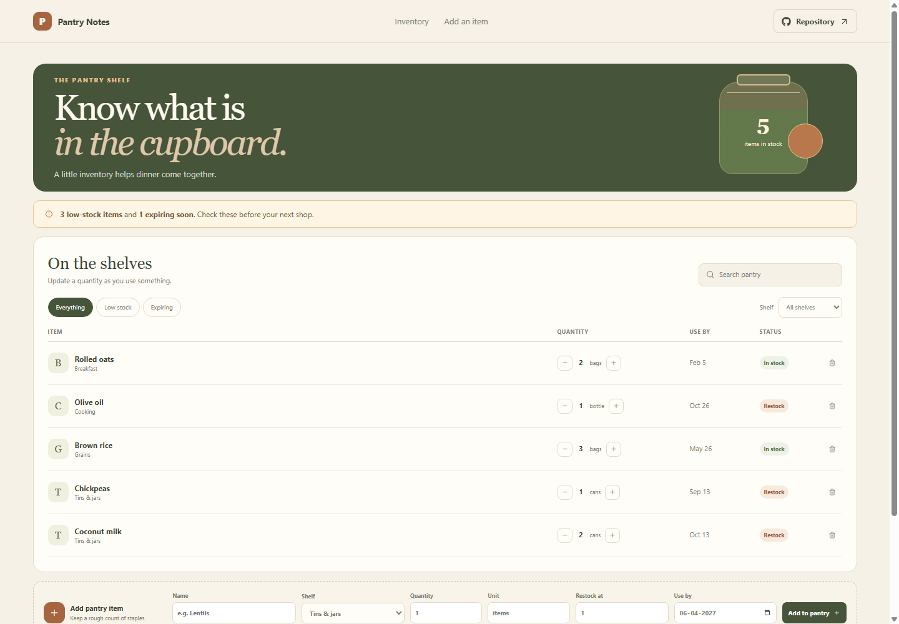

# Pantry Notes: Pantry Inventory Manager

Pantry Notes is a browser-local stock list for shelf staples. It helps you notice items that are running low or should be used soon before you plan another shop.



## Features

- Record an item, shelf, quantity, unit, restock threshold, and use-by date
- Adjust counts with plus and minus controls
- Filter by shelf, low stock, or items expiring within seven days
- Review low-stock and near-expiry counts above the inventory list
- Remove stock entries after confirming the item name

## Data and limits

Inventory is stored in this browser using localStorage. Counts are manual estimates. Expiry highlighting uses the date entered and is not a food-safety guarantee. Clearing the browser's site data removes saved inventory.

## Run locally

Requires Node.js 20.19+ or 22.12+. Run these commands from this project folder:

```bash
npm ci
npm run dev
```

Use the Vite URL printed in the terminal to open the app. Run these checks before contributing:

```bash
npm run lint
npm test
npm run build
```

This project is maintained in the [React Projects collection](https://github.com/a2rp/react_projects/tree/main/projects/pantry-inventory-manager).

## Links

- Portfolio: [ashishranjan.net](https://www.ashishranjan.net)
- GitHub: [a2rp](https://github.com/a2rp)
- CodePen: [ash1198](https://codepen.io/ash1198)
- LinkedIn: [aashishranjan](https://www.linkedin.com/in/aashishranjan)
- Facebook: [theash.ashish](https://www.facebook.com/theash.ashish/)
- YouTube: [Ashish Ranjan](https://www.youtube.com/@ashishranjan-ashz?sub_confirmation=1)
- Email: [ash.ranjan09@gmail.com](mailto:ash.ranjan09@gmail.com)
- Support: [Donation page](https://a2rp-donation-page.netlify.app/)
- Buy Me a Coffee: [Ashish Ranjan](https://buymeacoffee.com/ashishranjan)
- Patreon: [Ashish Ranjan](https://www.patreon.com/ashishranjan)