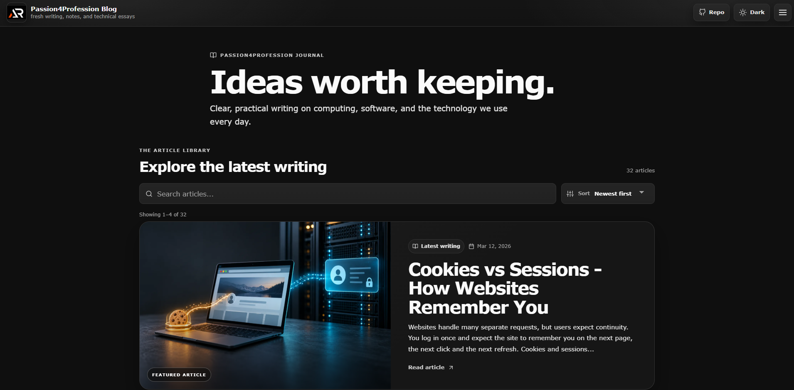

# Passion4Profession Blog

A React and Vite archive of beginner-friendly technical articles about computing, software, networking, operating systems, and cybersecurity.



## Features

- Searchable article archive with date-aware navigation
- Lazy-loaded routes for technical articles
- Dark and light themes saved in local storage
- Responsive sidebar navigation
- Share controls, scroll-to-top control, and icon-only footer links
- Generated blog index files for maintainable content

## Run locally

Requires Node.js 22.12+ or 24+. From this project folder:

```bash
npm ci
npm run dev
```

The build regenerates the blog index before creating production assets:

```bash
npm run lint
npm run build
```

This project is maintained in the [React Projects collection](https://github.com/a2rp/react_projects/tree/main/projects/passion4profession-blog).

## Links

- Portfolio: [ashishranjan.net](https://www.ashishranjan.net/)
- GitHub: [a2rp](https://github.com/a2rp)
- CodePen: [ash1198](https://codepen.io/ash1198)
- LinkedIn: [aashishranjan](https://www.linkedin.com/in/aashishranjan)
- Facebook: [theash.ashish](https://www.facebook.com/theash.ashish/)
- YouTube: [Ashish Ranjan](https://www.youtube.com/@ashishranjan-ashz?sub_confirmation=1)
- Email: [ash.ranjan09@gmail.com](mailto:ash.ranjan09@gmail.com)
- Support: [Donation page](https://a2rp-donation-page.netlify.app/)
- Buy Me a Coffee: [a2rp](https://buymeacoffee.com/a2rp)
- Patreon: [a2rp](https://patreon.com/a2rp)