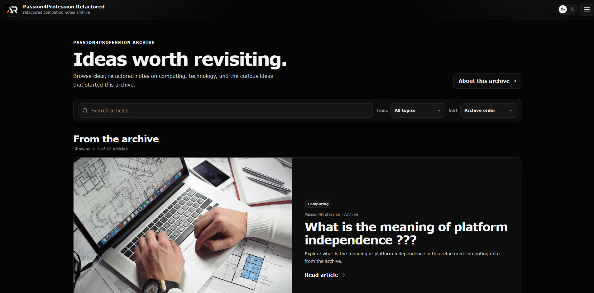

# Passion4Profession Refactored

A React and Vite archive that preserves and reorganizes beginner-friendly computing notes from the original Passion4Profession blog.



## Features

- Searchable archive navigation for computing topics
- Lazy-loaded pages for a focused reading experience
- Responsive sidebar with active-topic scrolling
- Dark and light themes saved in local storage
- Hardware, software, networking, storage, programming, and reference topics
- Share controls, scroll-to-top control, and icon-only footer links

## Run locally

Requires Node.js 20.19+ or 22.12+. From this project folder:

```bash
npm ci
npm run dev
```

To build the archive locally:

```bash
npm run lint
npm run build
```

This project is maintained in the [React Projects collection](https://github.com/a2rp/react_projects/tree/main/projects/passion4profession-refactored).

## Existing preview

[Open the existing Vercel preview](https://passion4profession-refactored.vercel.app/).

## Links

- Portfolio: [ashishranjan.net](https://www.ashishranjan.net/)
- GitHub: [a2rp](https://github.com/a2rp)
- CodePen: [ash1198](https://codepen.io/ash1198)
- LinkedIn: [aashishranjan](https://www.linkedin.com/in/aashishranjan)
- Facebook: [theash.ashish](https://www.facebook.com/theash.ashish/)
- YouTube: [Ashish Ranjan](https://www.youtube.com/@ashishranjan-ashz?sub_confirmation=1)
- Email: [ash.ranjan09@gmail.com](mailto:ash.ranjan09@gmail.com)
- Support: [Donation page](https://a2rp-donation-page.netlify.app/)
- Buy Me a Coffee: [a2rp](https://buymeacoffee.com/a2rp)
- Patreon: [a2rp](https://patreon.com/a2rp)