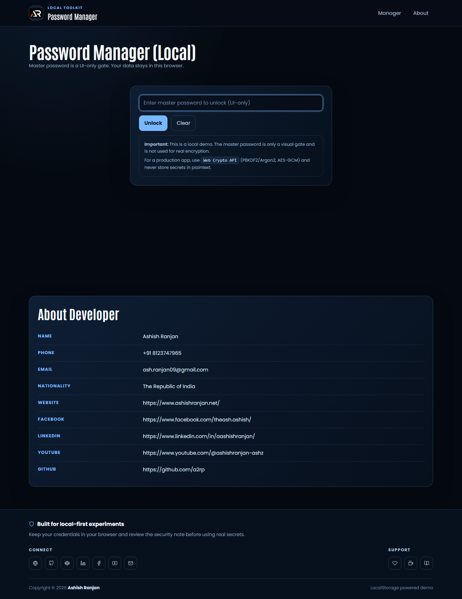

# Password Manager

A local-first React credential workflow demo for practicing credential CRUD, password generation, search, filters, and sorting in the browser.



## Features

- UI-only session unlock screen with a clear security disclaimer
- Add, edit, duplicate, delete, reveal, and copy credentials
- Generate passwords with the browser crypto API
- Search by site, username, URL, or tag
- Filter by tag and sort by recent update, site, or username
- LocalStorage persistence with a responsive dark interface

## Security limitation

This is a UI practice project. The unlock screen does not encrypt data, and credentials are stored as plain browser data. Do not use it for real secrets.

## Run locally

Requires Node.js 20.19+ or 22.12+. From this project folder:

```bash
npm ci
npm run dev
```

Run checks and build the app with:

```bash
npm run lint
npm run build
```

This project is maintained in the [React Projects collection](https://github.com/a2rp/react_projects/tree/main/projects/password-manager).

## Links

- Portfolio: [ashishranjan.net](https://www.ashishranjan.net/)
- GitHub: [a2rp](https://github.com/a2rp)
- CodePen: [ash1198](https://codepen.io/ash1198)
- LinkedIn: [aashishranjan](https://www.linkedin.com/in/aashishranjan)
- Facebook: [theash.ashish](https://www.facebook.com/theash.ashish/)
- YouTube: [Ashish Ranjan](https://www.youtube.com/@ashishranjan-ashz?sub_confirmation=1)
- Email: [ash.ranjan09@gmail.com](mailto:ash.ranjan09@gmail.com)
- Support: [Donation page](https://a2rp-donation-page.netlify.app/)
- Buy Me a Coffee: [a2rp](https://buymeacoffee.com/a2rp)
- Patreon: [a2rp](https://patreon.com/a2rp)