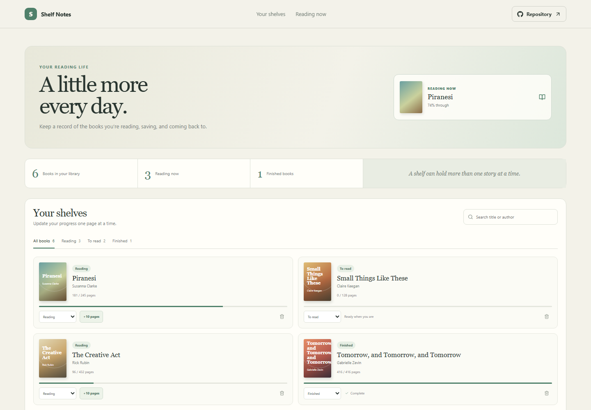

# Personal Book Library

Shelf Notes is a personal reading list for tracking books, reading progress, and finished titles without turning reading into a competition.



## Features

- A reading-now card highlights the first active book
- Library totals and shelf tabs above a searchable book grid
- Add titles and authors, change status, and update page progress
- Finish a book or remove it with a confirmation dialog
- Save book details and progress in this browser's LocalStorage

New books start with an estimated 240 pages; sample books include page totals for progress display.

## Run locally

Use Node.js and npm from this project folder:

```bash
npm ci
npm run dev
```

Run the checks and create a production build with:

```bash
npm test
npm run lint
npm run build
```

This project is maintained in the [React Projects collection](https://github.com/a2rp/react_projects/tree/main/projects/personal-book-library).

## Links

- Portfolio: [ashishranjan.net](https://www.ashishranjan.net)
- GitHub: [a2rp](https://github.com/a2rp)
- CodePen: [ash1198](https://codepen.io/ash1198)
- LinkedIn: [aashishranjan](https://www.linkedin.com/in/aashishranjan)
- Facebook: [theash.ashish](https://www.facebook.com/theash.ashish/)
- YouTube: [Ashish Ranjan](https://www.youtube.com/@ashishranjan-ashz?sub_confirmation=1)
- Email: [ash.ranjan09@gmail.com](mailto:ash.ranjan09@gmail.com)
- Support: [Donation page](https://a2rp-donation-page.netlify.app/)
- Buy Me a Coffee: [a2rp](https://buymeacoffee.com/a2rp)
- Patreon: [a2rp](https://patreon.com/a2rp)