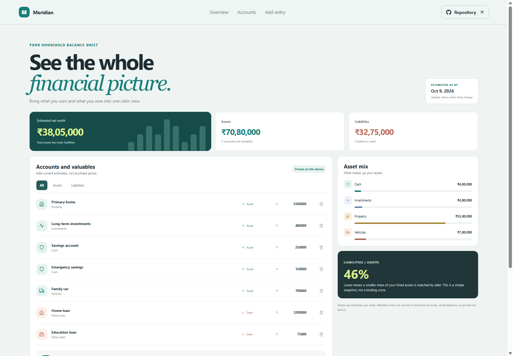

# Meridian Net Worth Dashboard

Meridian gives a household one place to record estimated asset and debt balances and see the difference between them.

## What it includes

- Net worth, assets, liabilities, and liabilities-to-assets summaries.
- Asset groups for cash, investments, property, vehicles, and other assets.
- Liability groups for common loans and other debt.
- Editable value fields, asset/debt filters, add controls, and confirmed removal.
- A simple asset mix chart.
- Indian rupee display and local browser storage.

## How to use it

Review the starter balances, then edit any current value directly in the account list. Choose Asset or Liability to add a balance and select its category. Use the list filters to focus on what is owned or owed. Remove an entry after confirming the action.

## Saving and data

Balances are saved in this browser's LocalStorage, which is not encrypted by this app and can be read by someone with access to the browser profile. Meridian does not connect to financial accounts, verify balances, sync data, or provide tax or lending advice. Starter values are examples. Avoid storing account credentials or other highly sensitive information. If browser storage is blocked or full, changes remain in memory for the current session and a warning appears; they will not survive a refresh.

## Run locally

Requirements: Node.js 20.19+ or 22.12+ and npm. Run `npm ci` to install dependencies, `npm run dev` to start the local server, and `npm run lint`, `npm test`, and `npm run build` to check the project.

Project source: [react_projects collection](https://github.com/a2rp/react_projects/tree/main/projects/personal-net-worth-dashboard).

## Future improvements

Ideas that are not implemented yet: multiple household profiles, dated balance history, and a net worth trend chart across saved months.

## Links

- Portfolio: [https://www.ashishranjan.net](https://www.ashishranjan.net)
- GitHub: [https://github.com/a2rp](https://github.com/a2rp)
- CodePen: [https://codepen.io/ash1198](https://codepen.io/ash1198)
- LinkedIn: [https://www.linkedin.com/in/aashishranjan](https://www.linkedin.com/in/aashishranjan)
- Facebook: [https://www.facebook.com/theash.ashish/](https://www.facebook.com/theash.ashish/)
- YouTube: [https://www.youtube.com/@ashishranjan-ashz?sub_confirmation=1](https://www.youtube.com/@ashishranjan-ashz?sub_confirmation=1)
- Email: [mailto:ash.ranjan09@gmail.com](mailto:ash.ranjan09@gmail.com)

## Support

- Support: [https://a2rp-donation-page.netlify.app/](https://a2rp-donation-page.netlify.app/)
- Buy Me a Coffee: [https://buymeacoffee.com/ashishranjan](https://buymeacoffee.com/ashishranjan)
- Patreon: [https://www.patreon.com/ashishranjan](https://www.patreon.com/ashishranjan)
